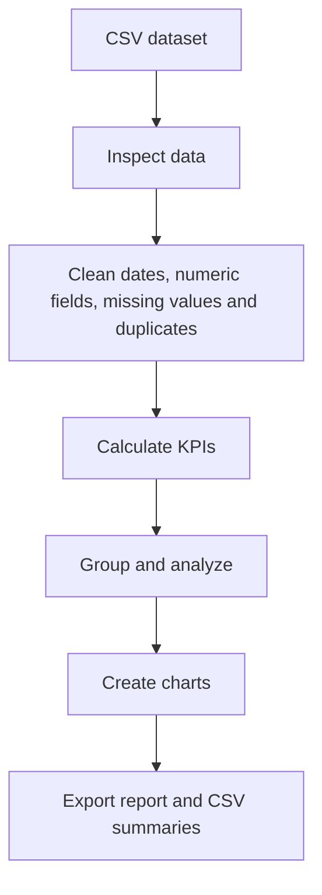

# 📊 Sales Data Analysis Using Python

<div align="center">


**A beginner-friendly end-to-end data analytics project using a generated retail sales dataset.**

</div>

## Overview
This project demonstrates a practical analytics workflow: load a CSV, inspect and clean data, calculate KPIs, explore sales by category/region/month/product/payment method, visualize patterns, and export tables and a written report. The sample data is synthetic and is not actual company data.

## Business objectives
- Understand the dataset and assess data quality.
- Calculate total revenue, orders, units sold and average order value.
- Compare sales by category and region.
- Examine month-by-month sales.
- Rank products by sales.
- Compare payment methods.
- Communicate findings and practical suggestions.

## Tools
- Python 3
- Pandas (data loading, cleaning, grouping and calculations)
- Matplotlib (charts)

## Folder structure
```text
Sales_Data_Analysis/
├── data/
│   └── sales_data.csv
├── outputs/                  # Generated when script runs
├── generate_dataset.py        # Re-create the synthetic CSV
├── analysis.py                # Main analysis workflow
├── requirements.txt
└── README.md
```

## Dataset dictionary
| Column | Description |
|---|---|
| Order_ID | Unique transaction identifier |
| Date | Order date |
| Region | Sales region (North, South, East, West) |
| Category | Product category |
| Product | Item name |
| Quantity | Units purchased |
| Unit_Price | Unit price in arbitrary currency units |
| Discount | Discount rate (decimal) |
| Sales | Transaction value after discount |
| Payment_Method | Payment method |

## Workflow


## Key metrics
- **Total Revenue:** sum of transaction sales.
- **Orders:** unique Order_ID count.
- **Units Sold:** total quantity.
- **Average Order Value:** total sales divided by unique orders.

## Analysis performed
1. **Data inspection:** preview rows, dimensions, data types, missing-value counts and duplicate count.
2. **Data cleaning:** parse dates, convert numerical fields, remove duplicate rows, remove rows missing essential fields, and exclude invalid quantity or negative sales rows.
3. **KPI summary:** revenue, unique orders, units and average order value.
4. **Category analysis:** sales totals by product category.
5. **Regional analysis:** sales totals by region.
6. **Monthly trend:** sales totals by month.
7. **Product analysis:** top ten products by sales.
8. **Payment analysis:** sales by payment method.
9. **Exports:** cleaned dataset, group summaries, charts and text report.

## Run the project
1. Install Python 3 and open this project directory in VS Code.
2. (Optional) Create and activate a virtual environment.
3. Install packages:
   ```bash
   pip install -r requirements.txt
   ```
4. Run:
   ```bash
   python analysis.py
   ```
5. Explore the `outputs/` folder.

To recreate the sample data (overwrites `data/sales_data.csv`):
```bash
python generate_dataset.py
```

## Output files
The script creates the following in `outputs/`:
- `cleaned_sales_data.csv`
- `sales_by_category.csv`
- `sales_by_region.csv`
- `monthly_sales.csv`
- `top_products.csv`
- `sales_by_payment.csv`
- `quantity_by_category.csv`
- `sales_by_category.png`
- `sales_by_region.png`
- `monthly_sales.png`
- `top_10_products.png`
- `sales_by_payment.png`
- `quantity_by_category.png`
- `sales_analysis_report.txt`

## Business questions
- Which category generates the highest sales?
- Which region contributes the most sales?
- How does revenue change across months?
- Which products lead in sales?
- Which payment method contributes the most sales?
- Which categories sell the most units?

## Recommendations (interpret after running)
- Consider stock and promotion priorities for top-selling categories and products.
- Explore reasons for weaker regional performance before deciding on campaigns.
- Use month-by-month patterns as a planning input, not as a forecast.
- Ensure customers have convenient payment options based on observed usage.

## Limitations
- Synthetic data: results are illustrative, not evidence about a real business.
- Sales are not profit; no cost data is included.
- Descriptive analysis does not establish causality or forecast demand.
- Currency is unspecified in the generated dataset.

## Learning outcomes
Practice CSV ingestion, data inspection, data cleaning, Pandas groupby/aggregation, KPI calculation, visualization, export workflows, and communicating analytics findings.

## Conclusion
This project provides a compact end-to-end introduction to data analytics. It can be extended with Excel, SQL, Power BI, customer segmentation, profit analysis, or forecasting using a suitable real dataset.
